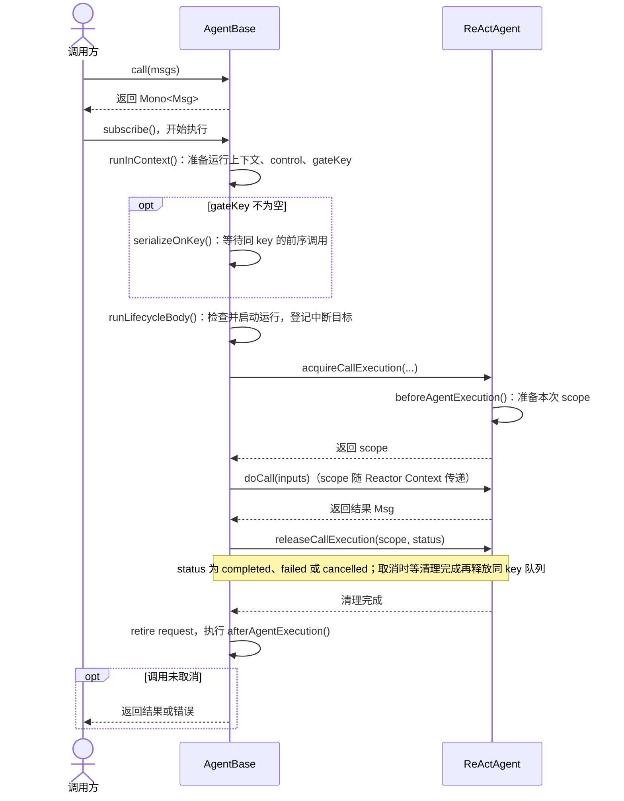

## AgentBase
> 核心入口

| 节点 | 源码入口 | 主要职责 |
|---|---|---|
| 调用方 | 外部节点；框架入口是 `io.agentscope.core.agent.AgentBase#call(List<Msg>)` | 调用并订阅 `Mono`；订阅后才开始执行 |
| AgentBase | `io.agentscope.core.agent.AgentBase#runInContext(...)`、`#runLifecycleBody(...)`、`#executeCallBody(...)`、`#serializeOnKey(...)`、`#acquireExecution()`、`#releaseExecution(...)` | 管理运行准入、排队、scope 生命周期和最终收尾 |
| ReActAgent | `io.agentscope.core.ReActAgent#acquireCallExecution(...)`、`#beforeAgentExecution(...)`、`#doCall(List<Msg>)`、`#releaseCallExecution(...)` | 代表具体 Agent 准备本次执行状态、运行逻辑并清理状态 |
