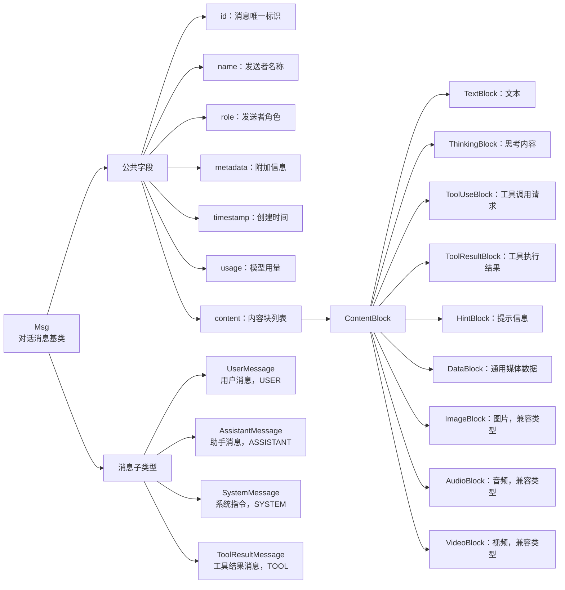
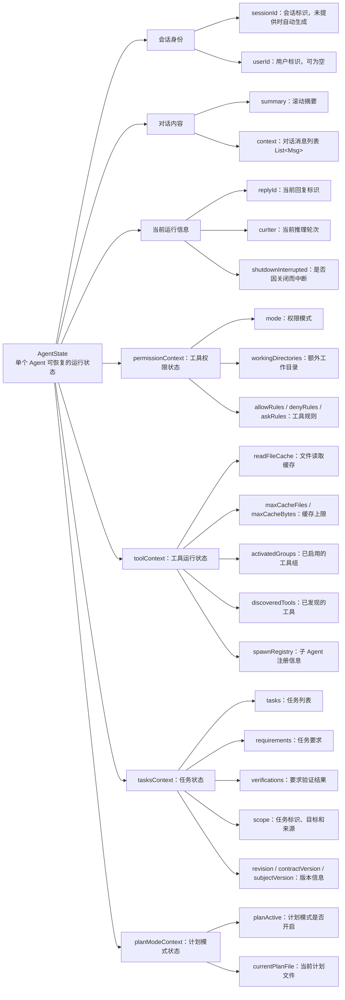
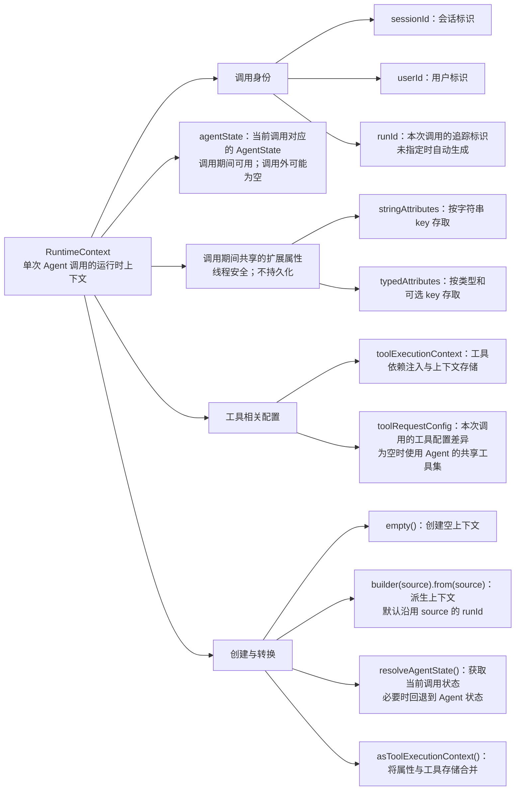
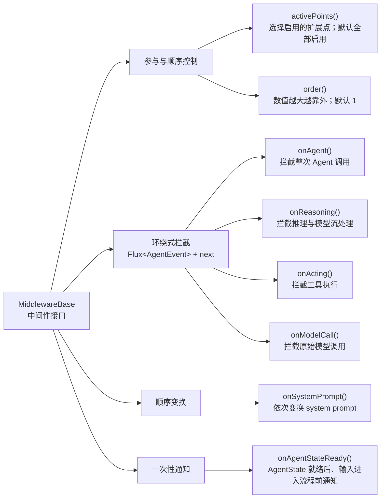
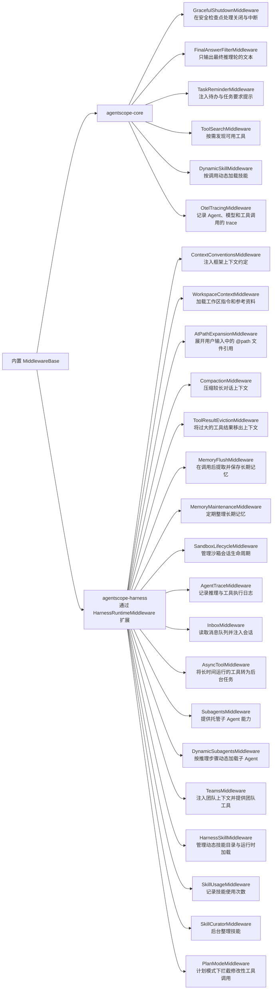

# 核心流程

## 对象

- Msg

> 最核心的对象，agents, users, and tools 直接沟通的主要单元

- AgentState

> agent 当前”瞬时”运行状态的完整快照

- RuntimeContext

> 单次 Agent 调用的运行时上下文，不参与持久化

- AgentEvent

> 事件是整个框架处理的核心

```mermaid
flowchart LR
    AE["AgentEvent<br/>抽象事件基类"]
    AE --> Common["通用字段"]
    Common --> Id["id：事件唯一标识"]
    Common --> CreatedAt["createdAt：创建时间"]
    Common --> Type["type：事件类型"]
    Common --> Source["source：来源 Agent"]
    Common --> Execution["execution：执行身份"]
    Common --> Metadata["metadata：附加信息"]
    AE --> Lifecycle["Agent 生命周期"]
    Lifecycle --> Start["AgentStartEvent：运行开始"]
    Lifecycle --> End["AgentEndEvent：运行结束"]
    Lifecycle --> Result["AgentResultEvent：最终结果"]
    AE --> Control["运行控制"]
    Control --> MaxIters["ExceedMaxItersEvent：达到迭代上限"]
    Control --> Stop["RequestStopEvent：请求停止"]
    AE --> Model["模型调用"]
    Model --> ModelStart["ModelCallStartEvent：模型调用开始"]
    Model --> ModelEnd["ModelCallEndEvent：模型调用结束"]
    AE --> Content["内容块"]
    Content --> TextStart["TextBlockStartEvent：文本块开始"]
    Content --> TextDelta["TextBlockDeltaEvent：文本增量"]
    Content --> TextEnd["TextBlockEndEvent：文本块结束"]
    Content --> ThinkingStart["ThinkingBlockStartEvent：思考块开始"]
    Content --> ThinkingDelta["ThinkingBlockDeltaEvent：思考增量"]
    Content --> ThinkingEnd["ThinkingBlockEndEvent：思考块结束"]
    Content --> DataStart["DataBlockStartEvent：数据块开始"]
    Content --> DataDelta["DataBlockDeltaEvent：数据增量"]
    Content --> DataEnd["DataBlockEndEvent：数据块结束"]
    Content --> Hint["HintBlockEvent：提示信息"]
    AE --> Tools["工具调用与结果"]
    Tools --> CallStart["ToolCallStartEvent：工具调用开始"]
    Tools --> CallDelta["ToolCallDeltaEvent：工具调用增量"]
    Tools --> CallEnd["ToolCallEndEvent：工具调用结束"]
    Tools --> ToolResultStart["ToolResultStartEvent：工具结果开始"]
    Tools --> Progress["ToolProgressEvent：工具执行进度"]
    Tools --> ResultText["ToolResultTextDeltaEvent：文本结果增量"]
    Tools --> ResultData["ToolResultDataDeltaEvent：数据结果增量"]
    Tools --> ToolResultEnd["ToolResultEndEvent：工具结果结束"]
    Tools --> Denied["AllToolsDeniedEvent：工具调用均被拒绝"]
    AE --> External["用户确认与外部执行"]
    External --> Confirm["RequireUserConfirmEvent：请求用户确认"]
    External --> ConfirmResult["UserConfirmResultEvent：用户确认结果"]
    External --> RequireExec["RequireExternalExecutionEvent：请求外部执行"]
    External --> ExecResult["ExternalExecutionResultEvent：外部执行结果"]
    AE --> Other["子 Agent 与扩展"]
    Other --> Subagent["SubagentExposedEvent：子 Agent 事件"]
    Other --> Custom["CustomEvent：自定义事件"]
```

- MiddlewareBase

> 中间件接口

内置中间件

