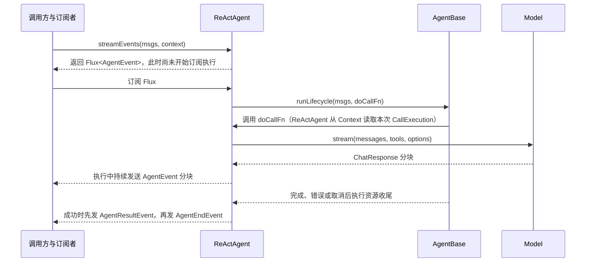

# Reactor 在 AgentScope Java 中的使用地图

这份笔记从本项目的真实调用链理解 Reactor。建议先掌握 Publisher、订阅、信号、组合、Context 和取消，再沿 ReActAgent 的一次请求读源码；不必先背完整 operator 清单。

项目当前在 `agentscope-dependencies-bom/pom.xml` 用 `reactor-bom.version=2025.0.2` 管理 Reactor 版本。`agentscope-core` 直接依赖 `reactor-core`；根 POM 给测试提供 `reactor-test`。以项目 POM 为版本事实来源，在线 `release` 文档可能更新得更快。

## 1. 先建立心智模型

Reactor 的 `Mono<T>` 和 `Flux<T>` 都是对一段处理过程的描述：

| 类型 | 发出的数据 | 本项目常见含义 |
|---|---|---|
| `Mono<T>` | 0 或 1 个值，之后完成；或者以错误结束 | 一次 Agent 调用、一次工具调用、一次异步状态保存 |
| `Mono<Void>` | 不发业务值，只表达完成或错误 | 保存、清理、通知等异步副作用 |
| `Flux<T>` | 0 到多个值，之后完成；或者以错误结束 | 模型分块、Agent 事件、SSE 事件 |

一个序列的主要信号是 `onNext* → onComplete` 或 `onNext* → onError`。取消是订阅者发出的另一种控制信号，不是 `onError`，也不是成功完成。

### 组装和执行是两件事

```java
Mono<Msg> result = agent.call(input); // 组装：描述要做什么
result.subscribe(...);                // 订阅：触发执行并接收信号
```

所以看到方法返回 `Mono` / `Flux`，不要立刻把它当作已经执行。大多数 Reactor 工厂和 operator 会等订阅后才工作；但 Java 方法中在创建 Publisher 之前就执行的普通语句仍然会立即执行。要把有副作用的工作也推迟到每次订阅时，代码常用 `Mono.defer`、`Flux.defer` 或 `deferContextual`。

尤其注意 `Mono.just(load())`：Java 会先执行 `load()`，再把结果交给 `just`；要延迟同步计算，可用 `Mono.fromCallable(this::load)`，要延迟创建另一条 Publisher，可用 `Mono.defer(this::loadAsync)`。`fromCallable` 本身不切线程，若 `load()` 会阻塞，还得看是否有合适的 Scheduler。

订阅者还能通过 Reactive Streams 的 `request(n)` 表达当前需要多少元素，这就是 backpressure 的基础。operator 可能调整或预取需求，不能只看最下游的 request 就推断源头行为。常见 lambda 版 `subscribe()` 会请求不受限的元素数；本项目的事件桥接使用 `Flux.create(..., BUFFER)`，阅读慢消费者或大事件量场景时，也要查看对应的 sink overflow 策略。Reactor 不会因为返回了 `Flux` 就自动给生产者限速。

还要分清 cold 和 hot：cold 序列通常每个订阅者从头启动一次；hot 序列则可能共享正在发生的事件，晚到的订阅者未必能重放过去的数据。`ReActAgent#buildAgentStream()` 使用 `Flux.deferContextual`，所以同一个 `call()` 返回值被订阅两次，通常表示启动两次 Agent 执行，而不是第二次读取第一次的结果。遇到手动 `subscribe()` 时，先确认代码是否是在有意启动第二条执行。

### `Mono.empty()` 不是 `null`

`Mono.empty()` 表示成功完成但没有 `onNext`。`Mono<Void>` 也是通过完成信号表达“工作完成”。这解释了为什么：

- `then(next)` 等前一段完成，丢弃其值，再执行 `next`。
- `thenReturn(value)` 等前一段完成后发出指定值。
- `switchIfEmpty(fallback)` 只在上游没有发出值时切换。
- `onErrorResume(fallback)` 处理错误信号；错误已经终止了上游，fallback 是接上的新序列。

## 2. 项目里 Reactor 负责什么

| 层 | 主要用法 | 代表入口 |
|---|---|---|
| Core Agent | 对外返回 `Mono<Msg>` / `Flux<AgentEvent>`；串起生命周期、模型推理、工具执行、事件和状态保存 | `io.agentscope.core.ReActAgent`、`io.agentscope.core.agent.AgentBase` |
| Model 扩展 | 以 `Flux<ChatResponse>` 输出模型流式片段；将 SDK / HTTP 结果映射成统一响应 | `io.agentscope.core.model.Model`、`io.agentscope.extensions.model.openai.OpenAIChatModel` |
| Middleware | 包装 `next` 的事件流，过滤、补充或延迟事件 | `io.agentscope.core.middleware.MiddlewareChain`、`io.agentscope.harness.agent.middleware.AsyncToolMiddleware` |
| Harness | 后台运行 Agent、轮询任务状态、桥接消息与事件 | `io.agentscope.harness.agent.session.AgentSession` |
| Service | 将单次查询返回为 `Mono`，将会话事件和心跳合并为 SSE `Flux` | `io.agentscope.builder.web.api.AgentSessionEventsController` |
| 测试 / 示例 | `StepVerifier` 订阅并验证值、错误、完成和取消；命令行示例可能在边界处 `block()` | `io.agentscope.core.agent.ReActAgentNewLoopReplyTest`、`io.agentscope.core.agent.AgentBaseTest`；文档示例中的 `blockLast()` |

## 3. 追一条 Agent 请求

下面以 `streamEvents()` 展示事件流路径。`call()` 复用同一条事件执行核心，再从中提取 `AgentResultEvent` 里的最终 `Msg`；因此两种入口不应该维护两套 Agent 执行逻辑。

`callInternal()` 用 `filter → takeLast(1) → next()` 取最终结果；`takeLast(1)` 要等事件流完成后才发出值，所以调用方收到 `Mono<Msg>` 时，生命周期收尾也已完成。



| 节点 | 源码入口 | 主要职责 |
|---|---|---|
| 调用方与订阅者 | 外部调用方，没有对应的 AgentScope Java 方法 | 调用 API 并订阅返回的 Publisher；在 WebFlux 中由框架订阅，在测试中由 `StepVerifier` 订阅 |
| ReActAgent | `io.agentscope.core.ReActAgent#streamEvents()`、`io.agentscope.core.ReActAgent#buildAgentStream()`、`io.agentscope.core.ReActAgent#buildIdentifiedAgentStream()`、`io.agentscope.core.ReActAgent#callInternal()`、`io.agentscope.core.ReActAgent#doCall()` | 每次订阅建立本次执行身份；生成 Agent 事件；`call()` 从共享事件流提取最终消息 |
| AgentBase | `io.agentscope.core.agent.AgentBase#runLifecycle()`、`io.agentscope.core.agent.AgentBase#runInContext()`、`io.agentscope.core.agent.AgentBase#runLifecycleBody()`、`io.agentscope.core.agent.AgentBase#executeCallBody()` | 串起执行准入、`RuntimeContext`、前后置 Hook、异常处理、资源释放和同 session 调用串行化 |
| Model | `io.agentscope.core.model.Model#stream()` | 返回模型响应片段流；具体 Provider 负责网络调用、解析和错误映射 |

源码阅读顺序：

1. 从 `io.agentscope.core.ReActAgent#call()` 或 `io.agentscope.core.ReActAgent#streamEvents()` 开始。
2. 看 `io.agentscope.core.ReActAgent#callInternal()` 如何把 `io.agentscope.core.ReActAgent#buildAgentStream()` 过滤成最终消息。
3. 看 `io.agentscope.core.ReActAgent#buildAgentStream()` 的 `Flux.deferContextual`：每次订阅如何得到有效 `RuntimeContext` 和执行身份。
4. 看 `io.agentscope.core.ReActAgent#buildIdentifiedAgentStream()` 如何用 `Flux.create` 接收生命周期和事件。
5. 进入 `io.agentscope.core.agent.AgentBase#runLifecycle()`、`io.agentscope.core.agent.AgentBase#runLifecycleBody()`，跟 `using` / `usingWhen` 的正常、失败、取消清理。
6. 再回到 `io.agentscope.core.ReActAgent.CallExecution#reasoning()`、`io.agentscope.core.ReActAgent.CallExecution#acting()`、`io.agentscope.core.ReActAgent.CallExecution#modelCallStream()` 和 `io.agentscope.core.ReActAgent.CallExecution#runToolBatch()`。

## 4. 读懂最常出现的 operator

| Operator | 阅读时翻译成 | 项目中的观察点 |
|---|---|---|
| `map` | 同步地把一个值变成另一个值 | 模型 chunk 转换为事件字段、DTO 映射 |
| `flatMap` | 用当前值启动/组合另一段异步 Publisher | `io.agentscope.core.ReActAgent.CallExecution#reasoning()` 接 Hook、模型准备与工具结果；不要据此推断换了线程 |
| `flatMapMany` | 从一个 `Mono` 切到多值流 | `io.agentscope.builder.web.api.AgentSessionEventsController#stream()` 先异步取 session，再返回事件 Flux |
| `concatMap` | 按上游顺序，一个一个执行内层 Publisher | `io.agentscope.core.ReActAgent.CallExecution#preparedModelCallStream()` 逐块检查中断并生成事件；`io.agentscope.core.ReActAgent.CallExecution#evaluatePermissions()` 和 `io.agentscope.core.ReActAgent.CallExecution#acting()` 的工具结果后置 Hook 保序 |
| `then` / `thenReturn` | 只关心前一段完成，再接下一步 / 发一个指定值 | Hook、状态写入和生命周期步骤之间建立先后关系 |
| `collectList` | 等上游完成，把多个值收集成一个 List | 汇总权限 verdict 或一批工具结果后统一决策 |
| `switchIfEmpty` | 上游没有值时走另一条路 | `io.agentscope.core.ReActAgent#doCall()` 处理空结果时仍保存会话状态 |
| `onErrorResume` | 上游失败后切换到备用 Publisher | `io.agentscope.core.ReActAgent#doCall()` 保存失败状态；`io.agentscope.core.ReActAgent.CallExecution#executeToolCalls()` 将一般工具异常转换成工具错误结果 |
| `doOnNext` / `doOnError` | 观察信号或做附带动作，不替换信号 | 记录结果、日志或更新状态 |
| `doFinally` | 完成、错误、取消都会执行的收尾钩子 | `io.agentscope.core.agent.AgentBase#runInContext()` 注销 shutdown request；`io.agentscope.harness.agent.session.AgentSession#launch()` 释放会话运行标记 |
| `defer` / `deferContextual` | 订阅时才创建 Publisher；后者还能读取 Reactor Context | `io.agentscope.core.ReActAgent#buildAgentStream()` 每次订阅创建独立执行范围；`io.agentscope.extensions.model.openai.OpenAIChatModel#doStream0()` 在重试时重新构造请求流 |
| `contextWrite` | 为当前订阅向上游提供 Context 数据 | `io.agentscope.core.ReActAgent#buildIdentifiedAgentStream()` 传入事件 sink / `RuntimeContext`；`io.agentscope.core.agent.AgentBase#executeCallBody()` 传递本次 `CallExecution` |
| `usingWhen` | 异步资源获取和按 complete/error/cancel 分别收尾 | `io.agentscope.core.agent.AgentBase#runLifecycleBody()` 管理本次调用执行 scope |
| `Flux.create` | 把回调式 / sink 式事件桥接成 Flux | `io.agentscope.core.ReActAgent#buildIdentifiedAgentStream()` 把生命周期事件写入事件流；取消时 dispose 内部订阅 |

### `flatMap` 和 `concatMap` 怎么选

当上游每个元素要调用返回 Publisher 的异步方法时，通常需要这两者之一。`flatMap` 允许多个内层 Publisher 重叠，结果到达顺序可能不同；`concatMap` 等前一个结束后再处理下一个，保留顺序，但吞吐量可能更低。两者都不等价于“开新线程”。

在 AgentScope 中，模型流片段要稳定地产生对应的 block delta / end 事件，权限和 Hook 也需要按工具调用次序处理，因此 `io.agentscope.core.ReActAgent.CallExecution#preparedModelCallStream()`、`io.agentscope.core.ReActAgent.CallExecution#evaluatePermissions()` 等路径用了 `concatMap`。看到 `flatMap` 时要继续确认业务是否依赖顺序；看到并行工具执行时，要继续追 Toolkit 的执行配置，而不是只凭 `flatMap` 下结论。

## 5. 线程不是 Reactor 自动安排的

返回 `Mono` / `Flux` 不代表任务会自动进入后台线程。没有 Scheduler 边界时，很多操作会沿用订阅线程或上游发信号的线程。理解这三点就够开始读项目：

- `subscribeOn(scheduler)` 影响订阅和源头执行所在线程，通常靠近源头使用。
- `publishOn(scheduler)` 从它所在的位置开始切换后续信号处理线程。
- `Schedulers.boundedElastic()` 常用于不能避免的阻塞调用；`Schedulers.parallel()` 用于定时或 CPU 工作，不应用来包住阻塞 I/O。

项目中的具体例子：

- `io.agentscope.extensions.model.openai.OpenAIChatModel#doStream0()` 用 `Flux.defer(...)` 延迟创建请求流，并通过 `subscribeOn(boundedElastic())` 指定订阅执行位置。`defer` 也让重试重新创建请求，而不是重复订阅已失败的同一个 HTTP 流。
- `io.agentscope.harness.agent.session.AgentSession#await()` 用 `Flux.interval` 周期检查任务，并把读取工作包装成 `Mono.fromCallable(...).subscribeOn(boundedElastic())`。
- `io.agentscope.builder.web.api.AgentSessionEventsController#stream()` 用 `Flux.interval` 发 SSE 心跳，并用 `subscribeOn(boundedElastic())` 包装读取 session / 刷新日志的同步准备工作。
- `io.agentscope.harness.agent.session.AgentSession#launch()` 是后台 Agent 运行的订阅所有者；它订阅 `run.stream()` 并在 `doFinally` 清理 active run 标记。

在 Agent 或 WebFlux 请求链里，不要用 `block()` 等待模型或工具结果；这样会把异步链重新变成阻塞调用，还可能卡住承载请求的线程。命令行入口或测试为了把结果交还给同步调用方，可以在边界处阻塞。

## 6. Reactor Context：本项目的“每次订阅携带的数据”

Reactor `Context` 跟着 Subscription 传播，不跟某个线程绑定；它适合放用户、session、run、取消控制等与业务值正交的信息。它的键值容器是不可变的，`contextWrite` 返回新 Context；但 Context 中保存的对象本身未必不可变。

本项目的关键路径：

1. `io.agentscope.core.ReActAgent#buildAgentStream()` 优先采用 API 传入的 `RuntimeContext`；未传时才从 Reactor Context 读取。
2. `io.agentscope.core.ReActAgent#buildAgentStream()` 在 `deferContextual` 中按本次订阅建立 execution / turn identity。
3. `io.agentscope.core.ReActAgent#buildIdentifiedAgentStream()` 把有效 `RuntimeContext` 和事件 sink 写入生命周期链的 Reactor Context。
4. `io.agentscope.core.agent.AgentBase#runInContext()` 读取 `RUNTIME_CONTEXT_KEY`、`RunControl` 等数据，并建立本次生命周期。
5. `io.agentscope.core.agent.AgentBase#executeCallBody()` 把本次 scope 放到 `CALL_SCOPE_KEY`。
6. `io.agentscope.core.ReActAgent#doCall()` 从 `ContextView` 取出本次 `CallExecution`，而不是从 Agent 实例字段取共享的当前调用状态。

这也是为什么并发调用时不能把 `RuntimeContext` 或当前 session 放在 Agent 的可变字段里：不同 subscription 可能交错、换线程；按 subscription 隔离才与执行边界一致。不要把 Reactor Context 当作 Map 来跨线程随意修改，也不要拿 `ThreadLocal` 替代它。

## 7. 错误、取消、业务中断和清理

这几个概念要分开看：

| 发生的事情 | Reactor 表现 | 本项目可追的位置 |
|---|---|---|
| 正常结束 | `onComplete` | `io.agentscope.core.agent.AgentBase#runLifecycleBody()` 的 complete cleanup |
| Publisher 失败 | `onError`，上游序列终止 | `io.agentscope.core.ReActAgent#doCall()` 的 `onErrorResume` 保存失败状态；`io.agentscope.core.ReActAgent.CallExecution#executeToolCalls()` 对一般工具异常生成错误结果 |
| 外部订阅者取消 | 取消 Subscription；不是 `onError` | `io.agentscope.core.ReActAgent#buildAgentStream()` / `io.agentscope.core.agent.AgentBase#runInContext()` 的 `doOnCancel`、`usingWhen` cancel cleanup |
| Agent 业务中断 | `RunControl` / interruption 状态被检查，执行逻辑决定如何结束 | `io.agentscope.core.ReActAgent.CallExecution#checkInterrupted()`、`io.agentscope.core.ReActAgent.CallExecution#reasoning()`、`io.agentscope.core.ReActAgent.CallExecution#acting()` |

`onErrorResume` 不会让已经失败的上游从出错处继续运行，而是用新的 Publisher 替换失败后的部分。工具调用里，这常表现为“捕获工具错误并把错误作为 ToolResult 返回给模型”，这属于业务恢复；外部取消则需要走取消收尾，不能指望 `onErrorResume` 捕获。

`io.agentscope.core.agent.AgentBase#runLifecycle()` 是学习资源收尾的好例子：它用 `Mono.using` 管理外层准入资源，`io.agentscope.core.agent.AgentBase#runLifecycleBody()` 用 `Mono.usingWhen` 等待异步执行 scope 的完成、失败或取消清理。取消时，某些已经开始的阻塞状态写入不能被 Reactor 直接中止；代码会等 cleanup 完成后再释放同 session 的执行 gate，避免旧写入覆盖后续调用。

## 8. 手动 `subscribe()`：找到订阅所有者

业务链优先组合并返回 Publisher，让上层统一处理结果、错误和取消：

```java
return saveState().then(callModel());
```

在本项目看到 `.subscribe()` 时先问“谁拥有这个订阅、谁取消它、错误去哪了、Context 有没有传过去？”有些地方是合理的订阅边界：

- `io.agentscope.harness.agent.session.AgentSession#launch()` 自己负责启动并跟踪后台 Agent run。
- `io.agentscope.core.ReActAgent#buildIdentifiedAgentStream()` 把生命周期 Mono 接到事件 sink，并把订阅 dispose 绑定到外层取消。
- `io.agentscope.core.agent.AgentBase#serializeOnKey()` 订阅 session gate 的尾部信号，以便 gate 在终止后删除自身。
- `io.agentscope.core.ReActAgent.CallExecution#runToolBatch()` 和 `io.agentscope.harness.agent.middleware.AsyncToolMiddleware#onActing()` 为 callback / 超时后的后台继续执行建立内层订阅，并自行桥接错误、事件与取消。

其中 `io.agentscope.harness.agent.middleware.AsyncToolMiddleware#onActing()` 很适合作为进阶案例：到时后向本轮事件流发占位结果、先结束当前 turn，而未完成的工具可以留在后台继续；此时它选择不再随外层取消 dispose 工具订阅。这里是显式的“订阅所有权转移”，不是普通 `flatMap` 能表达的简单组合。

内部手动订阅的代价是：父链不再自动管理内层的错误、取消和 Context。检查代码时应确认内层是否保存 `Disposable`、有没有 error handler、取消条件是什么，以及 Context 是否通过 `contextWrite` 传入。

## 9. 建议的学习顺序

沿你已有的[源码学习计划](源码学习计划.md)第 1–2 周推进，每次只追一个问题：

1. **先看基础信号。** 读 `Mono` / `Flux`、订阅、错误和 Scheduler 章节；用 `Mono.just`、`Mono.empty`、`Flux.just`、`Mono.error` 对照 `onNext` / `onComplete` / `onError`。
2. **追一次纯文本 Agent 调用。** 读 `io.agentscope.core.agent.ReActAgentNewLoopReplyTest` 的纯文本用例，再按第 3 节的顺序跟 `io.agentscope.core.ReActAgent#call()` → `io.agentscope.core.ReActAgent#buildAgentStream()` → `io.agentscope.core.agent.AgentBase#runLifecycle()` → `io.agentscope.core.ReActAgent.CallExecution#reasoning()` → `io.agentscope.core.model.Model#stream()`。
3. **追一个模型流片段。** 看 `io.agentscope.extensions.model.openai.OpenAIChatModel#doStream0()` 和 `io.agentscope.core.ReActAgent.CallExecution#preparedModelCallStream()`，逐个指出 `defer`、`concatMap`、chunk 到 event 的转换位置。
4. **追一次工具调用。** 从 `io.agentscope.core.ReActAgent.CallExecution#acting()` 到 `io.agentscope.core.ReActAgent.CallExecution#evaluatePermissions()`、`io.agentscope.core.ReActAgent.CallExecution#runToolBatch()`、`io.agentscope.core.ReActAgent.CallExecution#dispatchToolCalls()`，比较顺序操作与允许异步并行的位置。
5. **追取消与上下文。** 读 `io.agentscope.core.agent.AgentBaseTest`、`io.agentscope.core.agent.AgentRunTest` 和 `io.agentscope.core.shutdown.GracefulShutdownTest` 中对应场景，画清 cancel、interrupt、error 的不同收尾路径。
6. **最后看应用边界。** 看 `io.agentscope.harness.agent.session.AgentSession#launch()`、`io.agentscope.builder.web.api.AgentSessionEventsController#stream()`，理解谁订阅、谁持有取消句柄，以及 SSE 为什么合并持久事件与心跳。

建议边读边回答三个问题：**Publisher 在哪里组装？哪个地方第一次订阅？complete / error / cancel 分别由谁处理？** 能对每个链回答，基本就能顺着项目的大部分 Reactor 代码读下去了。

## 10. 官方参考

- [Reactor Reference Guide：Getting Started](https://projectreactor.io/docs/core/release/reference/gettingStarted.html)
- [Mono：0 或 1 个异步结果](https://projectreactor.io/docs/core/release/reference/coreFeatures/mono.html)
- [Flux：0 到 N 个异步元素](https://projectreactor.io/docs/core/release/reference/coreFeatures/flux.html)
- [订阅、取消和 backpressure](https://projectreactor.io/docs/core/release/reference/coreFeatures/simple-ways-to-create-a-flux-or-mono-and-subscribe-to-it.html)
- [错误处理](https://projectreactor.io/docs/core/release/reference/coreFeatures/error-handling.html)
- [Threading and Schedulers](https://projectreactor.io/docs/core/release/reference/coreFeatures/schedulers.html)
- [Reactor Context](https://projectreactor.io/docs/core/release/reference/advancedFeatures/context.html)
- [Hot vs Cold](https://projectreactor.io/docs/core/release/reference/advancedFeatures/reactor-hotCold.html)
- [资源清理](https://projectreactor.io/docs/core/release/reference/advancedFeatures/cleanup.html)
